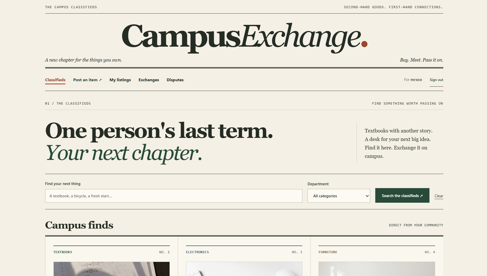
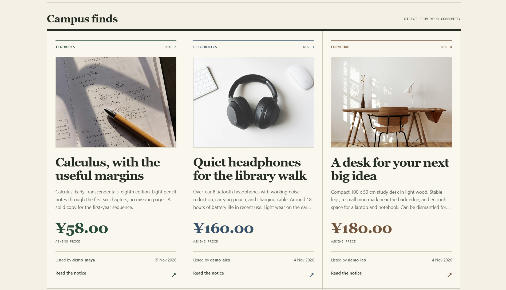
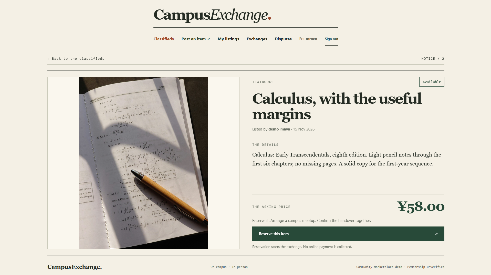
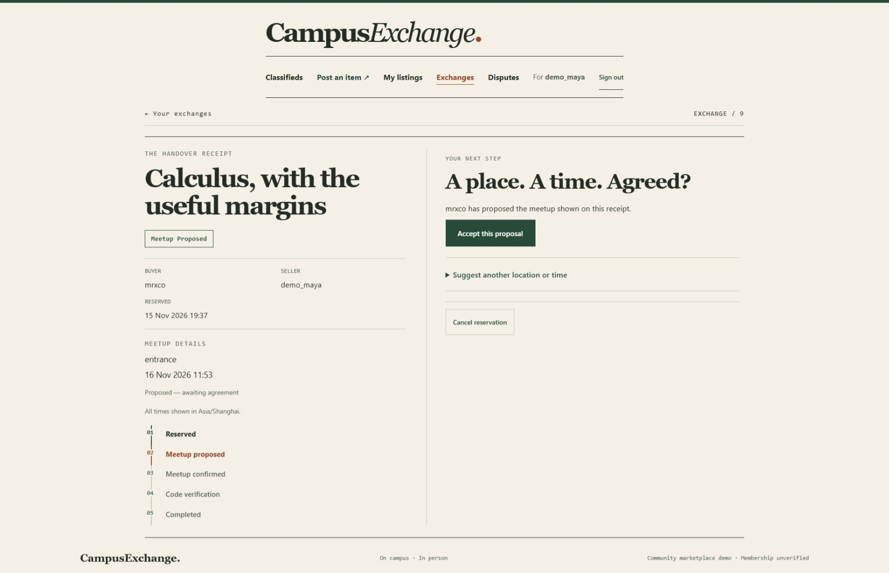
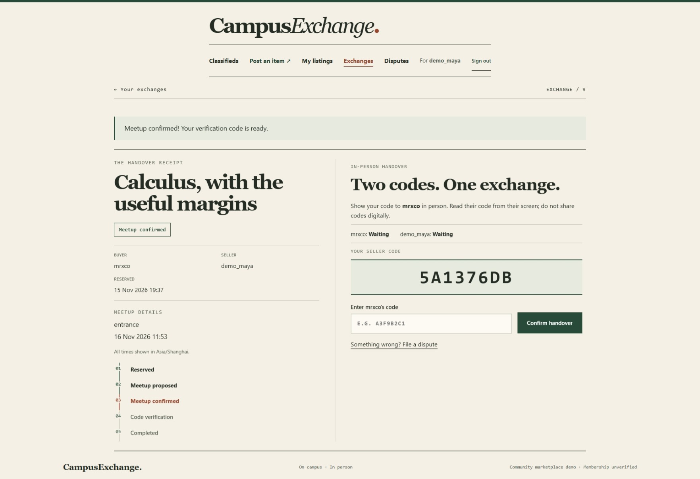
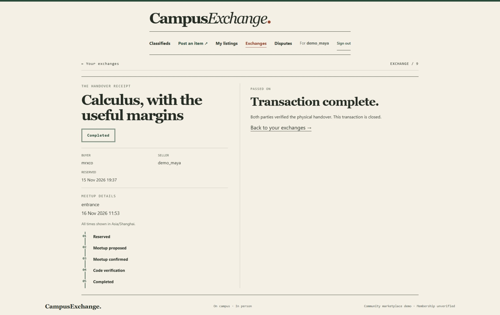
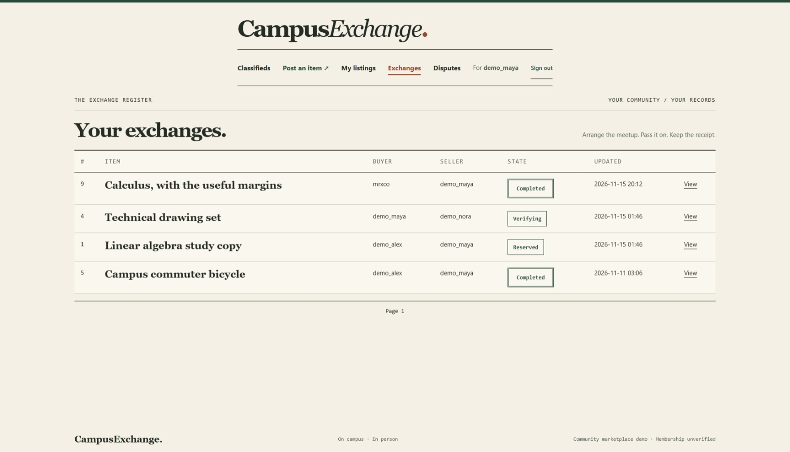
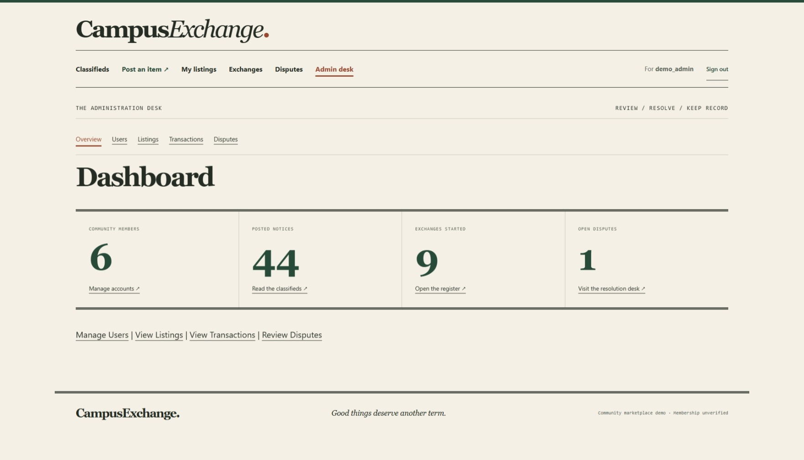
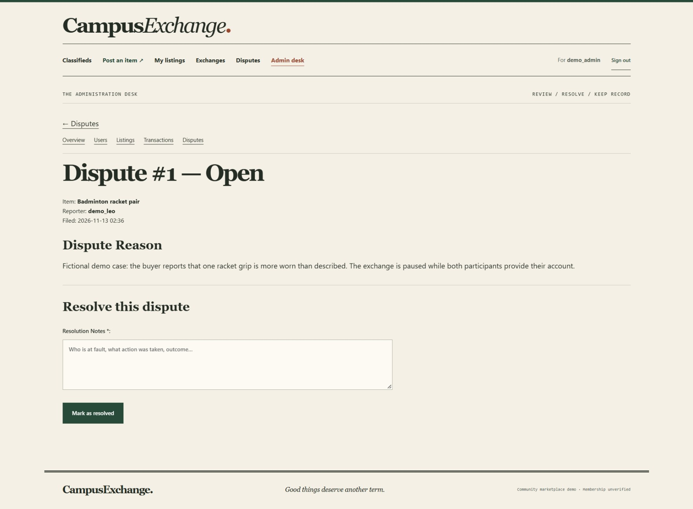

# CampusExchange

A server-rendered campus marketplace for listing second-hand items, reserving them, arranging meetups, and confirming physical handovers with reciprocal codes. Built with Java, Spring Boot, Thymeleaf, JDBC and MySQL.

The interface follows a contemporary campus newspaper: a bold masthead, editorial classifieds, paper forms, and a handover receipt. Ivory paper, ink, green accents and serif headlines carry through the user and administrator pages. Product photographs support the classifieds; payments remain outside the application.

## Preview

Explore the item, exchange and administrator flows

### Classifieds and listing details

### Meetup and reciprocal handover

### Administration and disputes

Screenshots show a local academic demo with fictional listings and representative photography. Demo handover codes are illustrative, not login credentials. Some captures precede the latest spacing refinements. Resolution notes are manually entered text; the application does not issue compensation, refunds or payments. These are screenshots, not a live hosted service. Mobile screenshot coverage was intentionally deferred.

## What it does

- Open demo registration and sign-in. Membership is **not campus-verified**.
- Browse, search and filter seven categories, with 24 records per page.
- Create, edit and withdraw your own available listings.
- Reserve another user's available item; one buyer can reserve it at a time.
- Propose or counter-propose a campus meetup. Only the other participant can accept the current proposal.
- Exchange codes in person. Both participants must enter the other's code before completion.
- File a dispute before completion. Both participants see its status and administrator notes.
- Administrators review records, resolve disputes, and deactivate non-admin accounts without deleting history.
- Live updates use bounded server-sent event connections. Unsaved forms show an update notice rather than being discarded.

This is a local academic/demo application. It does not process payments, prove delivery or identity, send email, or verify university enrollment.

## Requirements

- JDK 23 or newer (the project targets Java 23; checks were run with JDK 25).
- MySQL 8.0.16+ with InnoDB and enforced CHECK constraints.
- Maven 3.9+, or IntelliJ IDEA's bundled Maven.
- Available local port 8080, unless PORT is changed.

The POM retains Spring Boot 4.0.6 and WAR packaging. No frontend build or Node installation is needed. A Maven wrapper is not included: generation was blocked by repository connectivity in the implementation environment.

## Database setup

For a new installation, create a dedicated empty database in MySQL Workbench or the MySQL CLI:

~~~sql
CREATE DATABASE campusexchange CHARACTER SET utf8mb4;
USE campusexchange;
SOURCE /absolute/path/to/campus-exchange/database/schema.sql;
~~~

SOURCE is a MySQL CLI command. In Workbench, open database/schema.sql, select the empty database, and execute the script. Adjust the path on other computers.

Create a dedicated application user and grant only SELECT, INSERT and UPDATE on this database. The application retains history and does not need DELETE, CREATE or DROP privileges at runtime. Choose the password yourself; there are no shipped demo credentials.

**Existing installation:** back up the database and inspect SHOW CREATE TABLE for users, listings, handover_ledger and disputes. Do not run the fresh schema on existing tables. Review database/upgrade.sql, which adds account activation, wider password hashes, proposal versions and the one-dispute-per-ledger constraint. It stops on duplicate disputes or signs of a previous migration. MySQL DDL is not transactional; review any partial failure before retrying. Legacy schema compatibility has not been verified against your original database.

No schema is automatically created, migrated, reset or seeded on application startup.

## Local configuration

Copy config/application-local.properties.example to config/application-local.properties and fill in your database credentials. The local file is ignored. Never commit the completed local file.

Alternatively, remove the local override and set these environment variables in your terminal or IntelliJ run configuration:

| Variable | Default / purpose |
| --- | --- |
| DB_URL | jdbc:mysql://localhost:3306/campusexchange?serverTimezone=Asia/Shanghai |
| DB_USERNAME | campusexchange |
| DB_PASSWORD | Empty; supply your own value |
| PORT | 8080 |
| COOKIE_SECURE | false for localhost HTTP; true behind HTTPS |
| TEMPLATE_CACHE | false for development |

The imported local properties file can override the environment-backed defaults. Keep one configuration source to avoid connecting to the wrong database. Do not commit passwords or share the local file.

All meetup inputs and displayed times use **Asia/Shanghai**. Use the supplied JDBC timezone setting. If an older local JDBC URL omits it, add serverTimezone=Asia/Shanghai.

## Run in IntelliJ IDEA

1. Open this directory as a Maven project using pom.xml. Allow Maven to import dependencies.
2. Select JDK 23+ for both the project SDK and Maven runner.
3. Set the run working directory to this project root, so config/application-local.properties is found.
4. Complete database setup and configuration above.
5. Run com.campusexchange.CampusExchangeApplication and open http://localhost:8080.

Terminal alternative with Maven on PATH:

~~~powershell
mvn spring-boot:run
~~~

If mvn is unavailable, use IntelliJ's Maven tool window instead. Stop the application with the IDE stop button or Ctrl+C before rebuilding.

## Create an administrator

There is no public admin registration and no automatic promotion of an existing user.

In IntelliJ, create a Java Application run configuration for com.campusexchange.tools.AdminBootstrap, with this project as its working directory. Put a **new** username in program arguments. Supply CE_ADMIN_PASSWORD in that run configuration (8-128 characters), then run it once. An interactive terminal can supply the password through a hidden console prompt instead.

The command inserts one new administrator with a PBKDF2 password hash and exits. An existing username causes the database unique constraint to reject the operation. Remove CE_ADMIN_PASSWORD from the run configuration afterward. Never use a real personal password for a demo.

## Newspaper interface

- Classifieds use three columns on large screens, two on tablets and one on phones.
- Item detail pages combine an editorial description with a reservation notice.
- Account/posting forms, exchange receipts and the administration desk share the same paper design.
- CSS provides an initial unfold, advertisement corner lifts, native cross-document page turns where supported, and server-backed status stamps.
- Navigation and forms remain server-rendered. Unsupported browsers retain normal navigation; reduced-motion preferences disable decorative motion.
- Georgia is the editorial headline family. The app uses system fonts and makes no remote font requests.
- Live refreshes and history restoration do not replay decorative entrances. Unsaved form protection remains active.

## Exchange rules

~~~text
AVAILABLE listing -> RESERVED ledger
RESERVED <-> MEETUP_PROPOSED -> MEETUP_ARRANGED -> VERIFYING -> COMPLETED
RESERVED / MEETUP_PROPOSED -> CANCELLED (listing becomes AVAILABLE)
Any active ledger state -> DISPUTED
Administrator resolves dispute -> listing INACTIVE; ledger stays DISPUTED with resolution notes
~~~

Cancellation is unavailable after a meetup is accepted; participants can file a dispute. Codes expire 24 hours after the agreed meetup. Acceptance rejects past meetup proposals. Matching repeat verification requests are safe after completion. Codes are not payment credentials and should be shown only to the other participant in person.

A stale proposal cannot be accepted: forms carry the ledger version and must be reviewed after another update. Listing and ledger changes commit together under database locks. Administrators viewing another exchange do not receive participant codes or verification forms.

Deactivation blocks sign-in and the next protected request, closes live connections, and hides that seller's listings from browsing. Existing records and participants' history remain. Administrators are protected from deactivation through the application.

## Product photos

Members can add one optional JPEG or PNG photo when creating a listing, and keep, replace or remove it while the listing remains available. Photos must be at most 5 MB, 20 megapixels and 6,000 pixels on either side. The server checks actual contents, strips metadata by re-encoding to JPEG, and limits the longest edge to 1,600 pixels. Original filenames are never used. A replacement and removal cannot be requested together. Normal validation failures retain text drafts; browsers require selecting the photo again.

Files persist in the project-local uploads/listings directory (ignored by Git). UPLOAD_DIRECTORY can point to another persistent local directory. Back up these files together with MySQL; a WAR rebuild does not contain member uploads. The authenticated /media/listings/{generated-name}.jpg route serves only generated image identifiers. Bundled demo assets live under src/main/resources/static/images/demo. Their representative nature and provenance are documented in [photo credits](src/main/resources/static/images/demo/CREDITS.md). Missing images have a deliberate fallback rather than a broken-image icon.

Fresh installations use database/schema.sql, which selects the database named campusexchange. If using a different name, adjust its CREATE DATABASE and USE statements before execution. Existing installations must back up, select their database, then apply database/add-listing-images.sql once before starting the updated application. No automatic schema migration runs on startup. The nullable image_path column stores an application-relative reference; an empty string records explicit removal so a later demo import does not undo it.

**Demo photography:** all 43 photographs were supplied locally by the project owner in productimage/. Optimized JPEG copies are bundled in src/main/resources/static/images/demo/. Originals remain unchanged and are ignored by Git. Original web sources, photographers and licenses were not supplied; CREDITS.md records them as unverified rather than asserting permission or authorship. Photos are representative; the docking-station image is a desk setup and textbook images do not necessarily match the named editions.

To replace the demo catalog, prepare 43 distinct representative JPEGs locally and update demo-images.tsv with exact title, filename, source reference, creator and license. HTTP(S) photo-page references are supported; local:productimage/filename.jpg explicitly denotes owner-supplied local files. Unverified credits must remain labelled as such until real source details are supplied. Then run com.campusexchange.tools.DemoPhotos from IntelliJ with the project root as working directory. It uses the private demo account manifest, validates all 43 assets and provenance fields before applying a transaction, checks saved account/listing identities, preserves existing photos and explicit removals, and never updates the original user's listing. Repeating the command does not duplicate data. Future fresh demo seeding includes photos only when the complete valid catalog is bundled. Acquiring files is a preparation step, never a runtime download.

## Visual refinement conventions

Keep the full newspaper masthead on classifieds and the compact version on task pages. Category ink accents and alternating paper rows must preserve aligned listing modules. Essential metadata stays readable; item details show only actual listing facts, without inferred condition or accessories.

Member exchange/dispute tables become labelled summaries on narrow screens; administrator records retain tables. The exchange register uses a bounded desktop scroll region with sticky headings and visible pagination. Individual handovers place the summary/progress beside the current action, with expandable proposal editors and preserved validation drafts. Smaller screens retain natural page scrolling. Progress distinguishes current, completed and upcoming stages; disputes interrupt the timeline. Primary actions use filled buttons, while cancellation stays secondary.

Navigation transitions are 320ms; the larger first-visit paper entrance remains separate. Respect reduced-motion preferences. Live updates show a persistent notice and refresh only on request. POST buttons show pending text and recover after history navigation.

## Checks

Open src/test/java/com/campusexchange/AcceptanceCheck.java in IntelliJ and run its main method using the test classpath. Set the working directory to this project root. It reads local database configuration or DB_URL, DB_USERNAME and DB_PASSWORD.

**Use a local test-only MySQL account with CREATE/DROP DATABASE and TRIGGER permissions for this check.** It creates a uniquely named campusexchange_test_* database, executes the fresh schema, runs HTTP/service checks, and drops that exact database in a finally block. It never creates or drops the configured application database. An interrupted/killed Java process may leave its temporary database behind; inspect its name before removing it manually.

Coverage includes password hashes and legacy upgrades, input validation, competing reservations, stale/self acceptance, cancel/accept and verify/dispute races, reciprocal handover, duplicate dispute rejection, resolution, rollback, CSRF, roles, deactivation, duplicate listing submissions and rendered user/admin pages.

~~~powershell
mvn verify
~~~

This builds the WAR with the normal Maven lifecycle; the explicit database acceptance main is **not** automatically invoked by mvn verify. Run it separately as described above.

Optional motion-behavior check with Node.js (not required to run the application):

~~~powershell
node src/test/js/paper-check.cjs
~~~

The database check executes only the four table definitions from schema.sql in its disposable catalog, ignoring the interactive database-selection setup statements.

See [VERIFICATION.md](VERIFICATION.md) for current results and limitations.

## Local demo catalog and accounts

Run the main method of com.campusexchange.tools.DemoSeed in IntelliJ, using the main application classpath and this project root as the working directory. Configure your local database first. No arguments are needed. Starting the application never seeds or resets data.

It adds five fictional demo accounts (one ADMIN and four USER members), 36 available listings across all seven categories, seven additional history listings, eight exchanges and two disputes. Members can both buy and sell. Category counts: Textbooks 8, Electronics 6, Furniture 5, Clothing 4, Stationery 4, Bicycles 4 and Other 5. Prices retain the existing yuan currency. The complete bundled catalog supplies representative local photos; the application makes no runtime stock-photo downloads.

Exchange examples cover reserved, meetup proposed, meetup arranged, verifying, completed, cancelled, open dispute and resolved dispute. Cancellation reuses an available listing. The resolved dispute retains history and withdraws its listing; no platform payment or refund is implied. Meetup dates are relative to the first seed run, and handover codes expire normally. Rerunning does not refresh dates or reset examples.

Unique generated passwords and record IDs are saved to the ignored local file config/demo-accounts.properties. Keep it private and retain it for recovery. MySQL stores normal password hashes; plaintext demo passwords are kept only in that local manifest for testing. Never publish the file or put its passwords in the README.

All inserts use one database transaction. Existing records are preserved. A repeat run with the same manifest checks its references and makes no changes. Reserved username collisions, a mismatched database or incomplete references stop the command. Do not delete the manifest to force a rerun; inspect the reported condition first. Refresh the marketplace after seeding; no server restart is required.

The acceptance check also verifies seed rollback after an injected insert failure, retry with unchanged credentials, collision rejection, safe reruns, category totals, exchange consistency and all five demo logins and populated pages.

## Project layout

~~~text
src/main/java/com/campusexchange/
  controller/  HTTP routes and form redirects
  service/     authorization and transactional exchange workflows
  dao/         prepared JDBC queries
  entity/      database records
  filter/      sessions, CSRF and attempt limits
  config/      pagination view handling
  util/        passwords, tokens, validation and pagination
  tools/       explicit administrator bootstrap and local demo seed
src/main/resources/
  templates/   Thymeleaf views and shared navigation
  static/      shared CSS and JavaScript
  application.properties
src/test/java/  explicit disposable-database acceptance check
database/       fresh schema and reviewed legacy upgrade
config/         ignored local credentials and safe example
~~~

## Deployment boundaries

Sessions from the older loginUser/loginRole format require signing in again after this update.

Session state, form tokens, attempt limits and live connections are in memory for a single application instance. Restarting signs users out and drops these transient limits. Add shared state only when running multiple instances. PBKDF2 upgrades legacy salted SHA-256 passwords on successful sign-in; passwords are never stored in sessions.

Before public hosting, configure HTTPS, secure cookies, a least-privilege database account, backups and a current dependency advisory scan. The live-update channel is a convenience; the database validates every mutation. Browser visual acceptance and production hosting are separate from the HTTP rendering checks.

## Demo and third-party asset disclaimer

CampusExchange is a noncommercial academic portfolio demonstration, not a live marketplace. Accounts, listings, prices and exchange scenarios in the demo catalog are fictional. No payments are processed.

Product photographs and photographs visible in screenshots are representative illustrations. They do not establish item condition, availability, textbook edition or included accessories. Third-party photographs, book covers, trademarks and other depicted materials remain the property of their respective rights holders; no ownership or endorsement is claimed.

Original sources and redistribution permissions for the supplied product photographs have not been verified. Noncommercial use and this notice do not grant a license or replace required permission. See [photo credits](src/main/resources/static/images/demo/CREDITS.md). Before reusing or deploying this project, obtain appropriate permission or replace these assets with your own or appropriately licensed images. Rights holders can request correction or removal through this repository?s issue tracker.

No open-source license has been selected for the project code. Public availability alone does not grant a general license to reuse or redistribute it.
